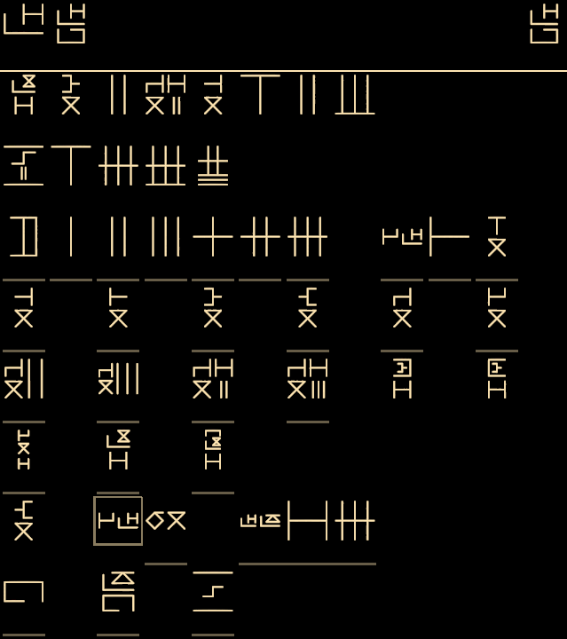

# Calculator

A [BepInEx 5](https://github.com/BepInEx/BepInEx) plugin for [Message From Aliens](https://store.steampowered.com/app/1858720/Message_From_Aliens/) that adds a base-7 calculator to the left panel.

## Installing

Install BepInEx first, if you haven't already, as described under [Requirements](#requirements). Then unzip the release zip into the game folder, the one that holds `MessageFromAliens.exe`. In Steam, right-click the game and choose Manage, then Browse local files, to open it. The zip holds `BepInEx/plugins/Calculator/`, so the mod lands in BepInEx's plugins folder. To update, unzip a newer release over it. To uninstall, delete `BepInEx/plugins/Calculator/`.

## Screenshot

**SPOILER ALERT** The screenshot and other documentation below will reveal some parts of the game that should be discovered organically. You can install the mod and use it without reading any further.



## Use

Once unlocked, a button at the right end of the left panel's top menu opens the calculator in the panel, and clicking it again returns to what the panel showed before. Clicking a link or button that opens a page in the left panel closes the calculator and shows that page, even when it is the page the calculator covers, without adding a second history entry for it. The calculator keeps its expression while closed.

The panel shows the current input expression, its result below it, and rows of keys as they unlock:

- The digits 0 to 6, a point key, a sign key, and the scientific-form key E. Digits typed after the point key go after the septimal point. Pressing the point key again switches to repeating digits, which repeat forever, and further presses cycle through the repeat glyphs with zero to three zero places before the repeating digits, then back to a plain fraction. Zeros typed just before the switch count as those places. Once repeating digits are typed, the cycle skips the plain fraction. `a E b` is a times 7 to the power b, as in the game's scientific form.
- Operations between two values.
- Functions of one value. Squares, cubes, and roots follow their operand. Other functions come before their operand, joined to it by the game's "on", and apply to the rest of the expression, as the game writes them.
- Constants.
- Settings: how division shows its result, and the significant figures.
- Keys to undo the last key pressed, clear the expression, and replace the expression with its result.

Evaluation order follows the game's lesson on it: functions that follow their operand apply first, then every operation applies from left to right, with no precedence between plus, minus, times, divide, exponent, and log. Typing 2 + 2 * 2 gives 8. E comes before all of these, joining the numbers on each side into one, as in the game's scientific form, so 2 + 1 E 2 is 2 + (1 E 2), and 1 E 2 squared is (1 E 2) squared. E takes a number on each side, so it cannot follow a function or start one.

While the calculator is open and no text field has the keyboard, typing presses its keys: the digits 0 to 6, `+`, `-`, `*`, `/`, `^` for exponents, the decimal separator from your regional settings (`.` or `,`) for the point key, `E` for the scientific-form key, `e` and `p` for the constants, `=` or Enter for the result, and Backspace to undo the last key pressed. `-` is the sign key at the start of a number and right after an operation, and subtraction elsewhere.

Keys not yet unlocked do nothing, and neither does an operation that cannot go where it is pressed. Keys that would do something are underlined, like the game's menu choices.

Numbers are written the way the game writes them. A result within rounding error of a fraction with a denominator up to 7^4 is shown as that fraction. A result that cannot be written exactly is shown as approximately equal, rounded to three base-7 places as the game rounds: the last digit goes up by one only when the next digit is 4 or more. A result that does not exist, such as from division by zero, is shown as such.

Until approximate results unlock, a result that could only be shown approximately does not exist, and the result key will not carry a result that would be approximate. After that, carrying an approximate result, or a quotient whose remainder is shown, makes the expression approximate: the approximately-equal sign stays in the last cell of the expression row, and every result is approximate until the expression is cleared or a new number is started.

Places the game has not yet shown you are never used: typed numbers go no higher than the largest place your dictionary has a digit in. Until the scientific form unlocks, a result that needs a larger place does not exist, and so does a nonzero result too small for three places. After that, values beyond the shown places are written in the scientific form, and so are values of 7^n and above, where n is the significant-figures setting, from 1 to 6; click its counter to change it.

Division shows a fraction, or the whole number rounded down and a remainder, as chosen in the settings row once fractions are unlocked. The remainder has the divisor's sign, as the game's lesson on remainders teaches, and is shown when the expression is a single division and the remainder is not zero. Numbers joined by E, and squares, cubes, and roots, count as one value of a single division. A division in a longer expression that drops a remainder makes the result approximate.

A log is written as in the game, value then base: 4 log 2 equals 2.

## Unlocking

Each feature unlocks once you have won as many of a chapter's quizzes as the number of the quiz that first tests it, whichever quizzes they are, the way the game's own menus count quizzes won. Winning the quizzes in order unlocks each feature with that quiz.

| Quizzes won | Unlocks |
|---|---|
| Arithmetic, 2 | The calculator, with the digits, a sign key, addition, and subtraction |
| Arithmetic, 3 | Multiplication, and division with a remainder |
| Arithmetic, 4 | Digits after the point, repeating digits, results with fractions, and the choice of fraction or remainder for division |
| Arithmetic, 9 | Squares and cubes |
| Arithmetic, 10 | Exponents and logs |
| Arithmetic, 11 | Square roots, approximate results, the scientific form and its E key, and the significant-figures setting |
| Geometry, 1 | Pi |
| Geometry, 7 | Cube roots |
| Advanced arithmetic, 1 | Sine and cosine, in radians |
| Advanced arithmetic, 2 | E |
| Advanced arithmetic, 4 | A key that puts a random value from 0 to 1, to three base-7 places, in the expression |

With [Mod Settings](https://github.com/sparr/messagefromaliens-mod-ModSettings) installed, each unlock is also announced in glyphs, in the game's own wording: a line at the end of the chapter's explanation, shown from the start, says how many of the chapter's quizzes to win to unlock it, and the page the game shows when that many are won says that you now unlock it.

## Configuration

`BepInEx/config/sparr.messagefromaliens.calculator.cfg`, created on first launch:

| Key | Default | Effect |
|---|---|---|
| `Calculator.Enabled` | `true` | Show the calculator's button once it is unlocked. |
| `Calculator.SignificantFigures` | `4` | Use the scientific form for values of 7 to this power and above, from 1 to 6. |
| `Calculator.Division` | `Fraction` | Show division results as a `Fraction`, or as a whole number and a `Remainder`, once fractions are unlocked. |

The calculator's settings row changes the last two. Each setting is tagged with its name in glyphs, and the mod names itself in glyphs, so Mod Settings can show them in the game. Mod Settings lists each setting exactly when its feature unlocks, as listed under [Unlocking](#unlocking).

## Requirements

- BepInEx 5.4.23.6 or later, `BepInEx_win_x64` build, unzipped into the game folder. Tested with Unity 6000.6.8f1.
- On Linux under Proton, set the Steam launch options to `WINEDLLOVERRIDES="winhttp=n,b" %command%`.
- .NET SDK 8 or later to build.

## Building

```sh
dotnet build -c Release
```

The build copies `Calculator.dll` to `<game>/BepInEx/plugins/Calculator/`. Disable the copy with `-p:DeployToGame=false`.

The build looks for the game in `<SteamLibraryDir>/steamapps/common/Message From Aliens`. `SteamLibraryDir` comes from the first of these that is set:

1. `-p:SteamLibraryDir=/path/to/SteamLibrary` on the command line.
2. A `SteamLibraryDir` environment variable.
3. `GamePaths.props`, a copy of `GamePaths.props.example`. It is ignored by git.
4. Steam's default install location: `~/.local/share/Steam` on Linux, `C:\Program Files (x86)\Steam` on Windows.

For a game folder outside a Steam library, set `GameDir` to the game folder the same ways.

## Patches

| Method | Patch |
|---|---|
| `Draw.Write` | Prefix: adds the button to the left panel's menu, and while the calculator is open, draws it in place of the panel's title and text, with only the history buttons left in the menu. |
| `Draw.PushLeftText` | Prefix, after other mods' prefixes: closes the calculator when a click shows a page in the left panel, or when the game adds a history entry there. With the calculator open, skips a push of the entry under it, which the game would add again for a word's information. |
| `Global.LoadGame` | Postfix: clears the expression and closes the calculator, since another save slot has its own unlocks. |
| `Draw.UpdateText1` | Prefix and finalizer: mark the redraw, whose pushes of the current entry leave the calculator open. Postfix: boxes the current division setting and underlines the keys that would do something. |
| `Draw.Update` | Prefix and finalizer: mark a frame with a mouse click, for the `PushLeftText` prefix. Prefix and postfix: with the calculator open, makes the panel's history buttons show the entry under the calculator or the one after it, instead of stepping from it. |
| `HardwareCursor.Apply` | Prefix: gives the cursor the clickable color over the calculator's keys. |

The plugin's `LateUpdate` handles clicks on the button and keys, since the game ignores clicks on glyphs it does not know, and typing while the calculator is open.
